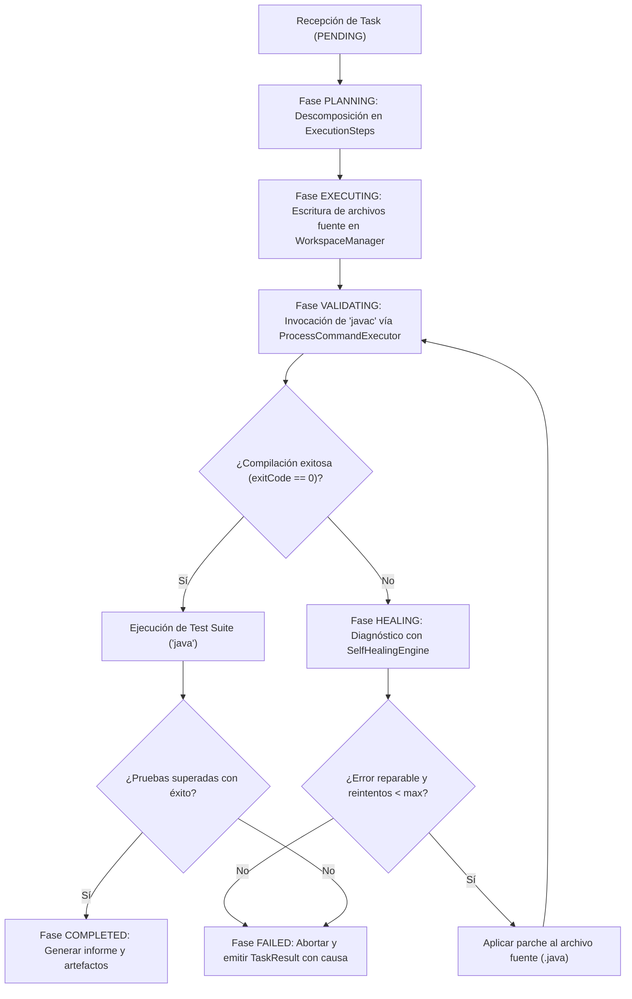

# Manual Técnico: ¿Cómo Funciona Terminal Agent y Cómo Ponerlo en Marcha?

Este documento proporciona una guía exhaustiva sobre la arquitectura interna, el flujo de ejecución autónomo y los pasos prácticos para configurar, ejecutar y extender el sistema **Terminal Agent**.

---

## 1. ¿Qué es Terminal Agent?

**Terminal Agent** es un sistema autónomo de ingeniería de software implementado en Java. A diferencia de un asistente conversacional tradicional que se limita a sugerir fragmentos de código, Terminal Agent toma posesión del ciclo completo de desarrollo:

1. **Recibe** un problema o requerimiento técnico en forma de [`Task`](file:///home/alumnot/Documentos/terminal-agent/src/com/agent/model/Task.java).
2. **Descompone** el problema en pasos operativos mediante una estrategia de planificación ([`TaskPlanner`](file:///home/alumnot/Documentos/terminal-agent/src/com/agent/planner/TaskPlanner.java)).
3. **Escribe** archivos fuente reales en un espacio de trabajo aislado y protegido ([`WorkspaceManager`](file:///home/alumnot/Documentos/terminal-agent/src/com/agent/workspace/WorkspaceManager.java)).
4. **Compila** el código generado invocando el compilador del sistema (`javac`) mediante procesos nativos protegidos ([`ProcessCommandExecutor`](file:///home/alumnot/Documentos/terminal-agent/src/com/agent/execution/ProcessCommandExecutor.java)).
5. **Autocorrige (Self-Healing)** cualquier error sintáctico, de compilación o excepción en tiempo de ejecución analizando el stacktrace y aplicando parches automáticos ([`SelfHealingEngine`](file:///home/alumnot/Documentos/terminal-agent/src/com/agent/healing/SelfHealingEngine.java)).
6. **Ejecuta** suites de pruebas automatizadas y entrega un informe estructurado final ([`TaskResult`](file:///home/alumnot/Documentos/terminal-agent/src/com/agent/model/TaskResult.java)).

---

## 2. Diagrama de Flujo del Ciclo de Vida Autónomo

El siguiente diagrama ilustra cómo transita el agente a través de sus fases:



---

## 3. Componentes Internos Clave

### 3.1. Núcleo y Orquestación
- [`AutonomousAgent`](file:///home/alumnot/Documentos/terminal-agent/src/com/agent/core/AutonomousAgent.java): Orquesta el bucle de ejecución. Controla los reintentos de autocorrección, la invocación de las herramientas y la emisión del resultado definitivo.
- [`AgentContext`](file:///home/alumnot/Documentos/terminal-agent/src/com/agent/core/AgentContext.java): Contenedor de configuración e inyección de dependencias (File Manager, Command Executor, Planner, Engine de autocorrección, timeouts y número máximo de reintentos).

### 3.2. Espacio de Trabajo Seguro (Sandbox)
- [`FileManager`](file:///home/alumnot/Documentos/terminal-agent/src/com/agent/workspace/FileManager.java) / [`WorkspaceManager`](file:///home/alumnot/Documentos/terminal-agent/src/com/agent/workspace/WorkspaceManager.java):
  - Normaliza todas las rutas relativas contra el directorio raíz del proyecto.
  - Bloquea activamente vulnerabilidades de evasión de directorios (`Directory Traversal` mediante secuencias como `../../etc/passwd`).
  - Crea automáticamente directorios padres intermedios cuando se escriben nuevos archivos.

### 3.3. Ejecución Segura de Procesos del Sistema Operativo
- [`CommandExecutor`](file:///home/alumnot/Documentos/terminal-agent/src/com/agent/execution/CommandExecutor.java) / [`ProcessCommandExecutor`](file:///home/alumnot/Documentos/terminal-agent/src/com/agent/execution/ProcessCommandExecutor.java):
  - Utiliza `ProcessBuilder` para ejecutar `javac`, `java` o scripts de terminal.
  - **Evita bloqueos de buffer del sistema operativo**: Consume de forma asíncrona tanto `stdout` como `stderr` en hilos de trabajo independientes (`CompletableFuture` respaldado por un thread pool dedicado).
  - **Control de tiempo (Timeouts)**: Si un proceso entra en bucle infinito o se bloquea, se detiene forzosamente al alcanzar el límite configurado (`Duration`).

### 3.4. Motor de Diagnóstico y Autocorrección (Self-Healing)
- [`SelfHealingEngine`](file:///home/alumnot/Documentos/terminal-agent/src/com/agent/healing/SelfHealingEngine.java):
  - Emplea expresiones regulares compiladas para extraer:
    1. Archivo objetivo causante del fallo (`filename.java`).
    2. Número exacto de línea donde se detectó el error.
    3. Clasificación del fallo (p. ej. `';' expected`, `cannot find symbol`, excepciones en tiempo de ejecución).
  - [`applyFix(...)`](file:///home/alumnot/Documentos/terminal-agent/src/com/agent/healing/SelfHealingEngine.java#L170): Genera la corrección sintáctica requerida y la aplica sobre el código fuente antes de que el agente vuelva a solicitar la compilación.

---

## 4. Requisitos del Entorno para que Funcione

Para compilar y ejecutar Terminal Agent en cualquier máquina (Linux, macOS o Windows), se requiere:

1. **Java Development Kit (JDK)**: Versión **OpenJDK 21** o **OpenJDK 25** instalada.
2. **Compilador javac accesible en PATH**:
   ```bash
   javac -version
   # Debe responder: javac 21.x o javac 25.x
   ```
3. **Máquina Virtual java accesible en PATH**:
   ```bash
   java -version
   # Debe responder con la versión de OpenJDK instalada
   ```
4. **Permisos de lectura/escritura**: Acceso habitual para crear directorios y ficheros dentro de la carpeta del proyecto.

> [!NOTE]
> No se requieren gestores de dependencias externos como Maven o Gradle para el funcionamiento base del agente, ya que el sistema incluye su propio compilador directo y un runner de pruebas nativo con cero dependencias externas.

---

## 5. Instrucciones de Puesta en Marcha (Paso a Paso)

### Paso 1: Clonar o Situarse en el Directorio del Proyecto
Abre una terminal y dirígete al espacio de trabajo:
```bash
cd /home/alumnot/Documentos/terminal-agent
```

### Paso 2: Compilar el Proyecto
Ejecuta `javac` para compilar todos los archivos `.java` en el directorio de salida `out/`:
```bash
mkdir -p out
javac -d out $(find src -name '*.java')
```

### Paso 3: Ejecutar la Suite de Pruebas Automatizada
Verifica que todos los subsistemas (sandbox, timeouts, diagnóstico de errores y bucle de autocorrección) están al 100% operativos:
```bash
java -cp out com.agent.test.AgentTestSuite
```
Salida esperada:
```text
=================================================
Running Autonomous Agent Test Suite (Java 25)
=================================================
[TEST] WorkspaceManager Sandboxing and File Operations ... PASSED
[TEST] ProcessCommandExecutor Process Execution and Timeouts ... PASSED
[TEST] DefaultTaskPlanner Plan Generation ... PASSED
[TEST] SelfHealingEngine Javac Error Diagnosis ... PASSED
[TEST] AutonomousAgent End-to-End Self-Healing Workflow ... PASSED
-------------------------------------------------
Test Summary: 5/5 tests passed.
ALL TESTS PASSED WITH 100% SUCCESS.
```

### Paso 4: Ejecutar la Demostración Principal
Ejecuta el agente principal resolviendo una tarea completa de ingeniería de software (creación, compilación, ejecución concurrente y verificación de un `ConcurrentLruCache` con TTL):
```bash
java -cp out com.agent.Main
```

---

## 6. Cómo Crear tus Propias Tareas Autónomas en Código

Para utilizar Terminal Agent para resolver nuevos requerimientos en tus propios proyectos, solo necesitas instanciar el contexto, crear una [`Task`](file:///home/alumnot/Documentos/terminal-agent/src/com/agent/model/Task.java) y llamar a `executeTask`:

```java
import com.agent.core.AgentContext;
import com.agent.core.AutonomousAgent;
import com.agent.model.Task;
import com.agent.model.TaskResult;
import com.agent.planner.DefaultTaskPlanner;

import java.nio.file.Path;
import java.util.Map;

public class MyCustomWorkflow {
    public static void main(String[] args) {
        // 1. Inicializar el contexto anclado al directorio de trabajo deseado
        Path workspace = Path.of("./my-workspace");
        AgentContext context = AgentContext.createDefault(workspace);
        AutonomousAgent agent = new AutonomousAgent(context);

        // 2. Definir los archivos que el agente debe generar y validar
        Map<String, Object> taskContext = Map.of(
            DefaultTaskPlanner.CONTEXT_FILES_KEY, Map.of(
                "src/com/math/Fibonacci.java", """
                    package com.math;
                    public class Fibonacci {
                        public static long compute(int n) {
                            if (n <= 1) return n;
                            return compute(n - 1) + compute(n - 2);
                        }
                    }
                    """,
                "src/com/math/FibonacciTest.java", """
                    package com.math;
                    public class FibonacciTest {
                        public static void main(String[] args) {
                            if (Fibonacci.compute(7) != 13) {
                                throw new AssertionError("Fibonacci computation failed!");
                            }
                            System.out.println("Fibonacci tests passed.");
                        }
                    }
                    """
            ),
            DefaultTaskPlanner.CONTEXT_COMPILE_CMD_KEY, "javac -d out src/com/math/*.java",
            DefaultTaskPlanner.CONTEXT_TEST_CMD_KEY, "java -cp out com.math.FibonacciTest"
        );

        // 3. Crear la tarea técnica
        Task task = new Task("TASK-FIB-01", "Implement and verify Fibonacci calculator", taskContext);

        // 4. Ejecutar el ciclo de vida autónomo
        TaskResult result = agent.executeTask(task);

        // 5. Evaluar el resultado
        System.out.println("¿Exitoso?: " + result.isSuccess());
        System.out.println("Duración: " + result.getDuration().toMillis() + " ms");
        System.out.println("Resumen: " + result.getSummary());
    }
}
```

---

## 7. Mantenimiento y Extensibilidad

- **Para añadir nuevas herramientas de ejecución**: Implementa la interfaz [`CommandExecutor`](file:///home/alumnot/Documentos/terminal-agent/src/com/agent/execution/CommandExecutor.java) (por ejemplo, para ejecutar comandos en contenedores Docker o pods de Kubernetes).
- **Para incorporar nuevas estrategias de planificación**: Implementa la interfaz [`TaskPlanner`](file:///home/alumnot/Documentos/terminal-agent/src/com/agent/planner/TaskPlanner.java) (por ejemplo, para generar pasos a partir de modelos LLM o especificaciones OpenAPI).
- **Para ampliar el motor de autocorrección**: Añade nuevos patrones de expresiones regulares y estrategias de parcheo en [`SelfHealingEngine`](file:///home/alumnot/Documentos/terminal-agent/src/com/agent/healing/SelfHealingEngine.java) (por ejemplo, para resolución automática de importaciones faltantes o refactorizaciones de tipos).
